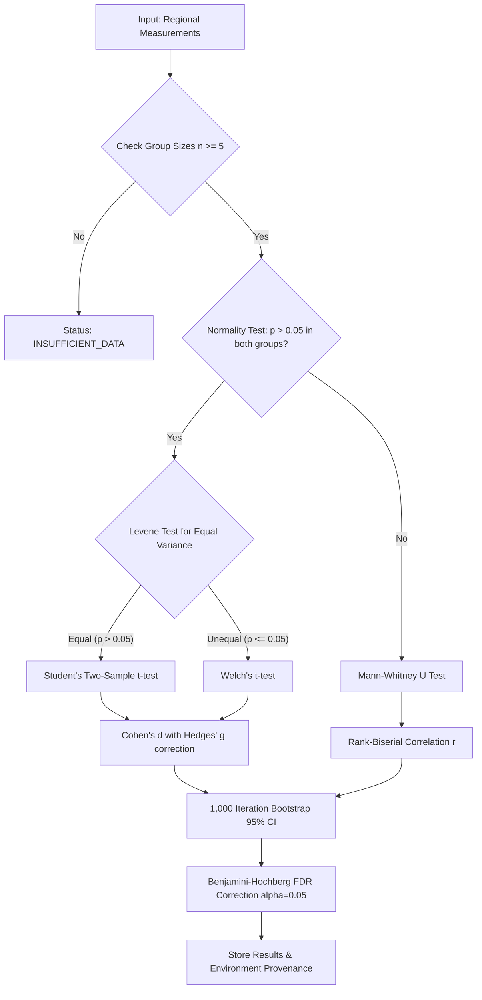

# MANAS Statistical Methods Specification

This document formally specifies the mathematical and algorithmic procedures implemented in the **MANAS (मनस्)** Statistical Analysis Engine (`analysis/engine.py`).

---

## 1. Overview of the Analytical Pipeline

---

## 2. Hypothesis Testing Selection

### A. Normality Evaluation
For each brain region, the disease distribution $X_D$ and control distribution $X_C$ are tested for departure from normality:
- If $n \le 50$: **Shapiro-Wilk test** ($W$).
- If $n > 50$: **D'Agostino-Pearson omnibus test** ($K^2 = Z_1(s)^2 + Z_2(k)^2$).
A parametric test is selected if and only if $p \ge 0.05$ across **both** cohorts.

### B. Equal Variance (Homoscedasticity)
Parametric comparisons evaluate variance equality using **Levene's test**. If $p_{\text{levene}} \le 0.05$, **Welch's t-test** with Satterthwaite degrees of freedom is executed:
$$t = \frac{\bar{X}_1 - \bar{X}_2}{\sqrt{\frac{s_1^2}{n_1} + \frac{s_2^2}{n_2}}}$$
$$\nu \approx \frac{\left(\frac{s_1^2}{n_1} + \frac{s_2^2}{n_2}\right)^2}{\frac{(s_1^2/n_1)^2}{n_1 - 1} + \frac{(s_2^2/n_2)^2}{n_2 - 1}}$$

### C. Non-Parametric Comparison
When normality is violated, the **Mann-Whitney $U$ test** evaluates rank-sum divergence:
$$U = n_1 n_2 + \frac{n_1(n_1 + 1)}{2} - R_1$$

---

## 3. Standardized Effect Sizes

### A. Parametric: Cohen's $d$ with Hedges' $g$ Correction
Pooled standard deviation:
$$s_{\text{pooled}} = \sqrt{\frac{(n_1 - 1)s_1^2 + (n_2 - 1)s_2^2}{n_1 + n_2 - 2}}$$
Cohen's $d$:
$$d = \frac{\bar{X}_1 - \bar{X}_2}{s_{\text{pooled}}}$$
Small-sample bias correction (Hedges' $g$):
$$g = d \left(1 - \frac{3}{4(n_1 + n_2 - 2) - 1}\right)$$

### B. Non-Parametric: Rank-Biserial Correlation
$$r_{\text{rb}} = 1 - \frac{2U}{n_1 n_2}$$
Bounded within $[-1, 1]$, where positive values indicate elevated disease burden.

---

## 4. Bootstrap Confidence Intervals

Empirical percentile confidence intervals ($95\%$) are constructed via non-parametric bootstrapping:
1. Draw $B = 1,000$ resamples with replacement from $X_D$ ($n_D$ items) and $X_C$ ($n_C$ items).
2. Calculate effect size estimate $\hat{\theta}^*_b$ for each bootstrap replicate $b \in \{1, \dots, B\}$.
3. Sort estimates and extract empirical percentiles:
$$\text{CI}_{95\%} = \left[\hat{\theta}^*_{(0.025 \cdot B)}, \; \hat{\theta}^*_{(0.975 \cdot B)}\right]$$

---

## 5. False Discovery Rate (FDR) Correction

To control type-I error inflation across multiple anatomical regions, MANAS uses the **Benjamini-Hochberg (BH) procedure**:
1. Sort raw $p$-values across $m$ regions in ascending order: $p_{(1)} \le p_{(2)} \le \dots \le p_{(m)}$.
2. Compute adjusted $p$-values:
$$p^{\text{adj}}_{(i)} = \min \left(1, \; \min_{j \ge i} \left\{ \frac{m}{j} p_{(j)} \right\} \right)$$
3. Regions with $p^{\text{adj}}_{(i)} \le 0.05$ are categorized as `FDR_SIGNIFICANT`.

---

## 6. Reproducibility & Provenance Standards

Every analysis run receives an immutable identifier (`MANAS-AD-YYYY-NNNNN`) and records:
- Exact random number generator seed.
- Execution timestamp and duration.
- Software runtime environment (Python version, operating system, core numerical package versions).
- Cryptographic SHA-256 parameter manifest.
